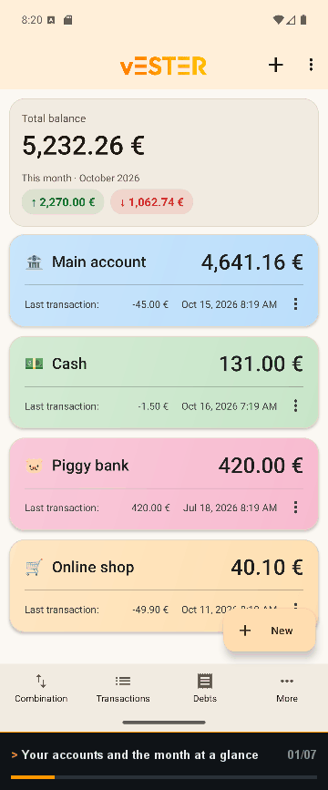
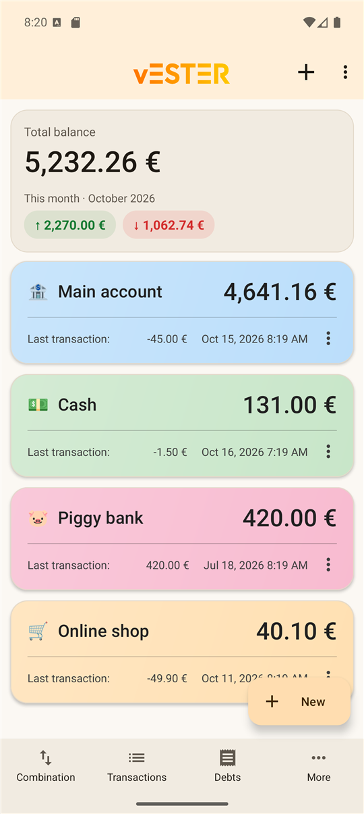
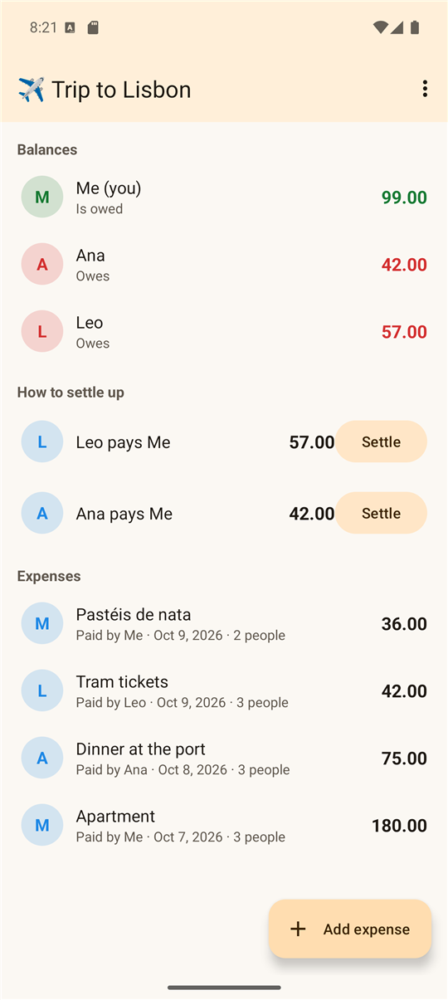
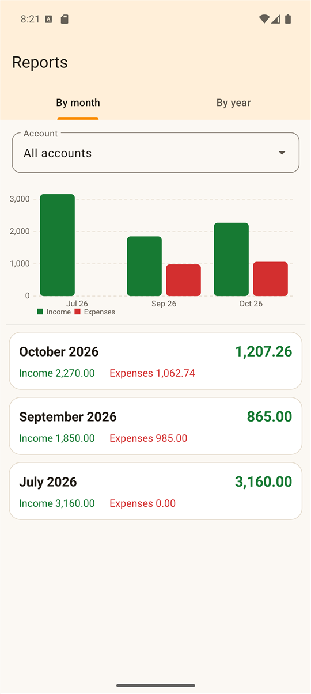
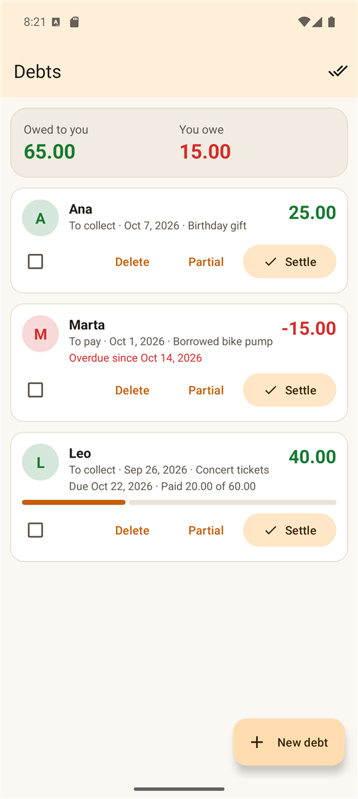

<div align="center">

# vESTER

### Your money, your people, your phone. Nothing else.

Keep track of your accounts, split expenses with friends and flatmates, and stay on budget,<br>
**without connecting a bank, creating an account or going online.**

[](#requirements)
[](#features)
[](LICENSE)
[](https://ko-fi.com/Eduzyrtin)
[](#privacy)
[](#features)
[](https://github.com/Eduzyrtin/vESTER/releases/latest)



**[Get it on Google Play](https://play.google.com/store/apps/details?id=com.sanabria.vester)** · **[Download the APK](https://github.com/Eduzyrtin/vESTER/releases/latest)** · [Features](#features) · [Privacy](#privacy) · [FAQ](#faq) · [Build from source](#building-from-source)

> **Free, on Google Play and GitHub.** vESTER is completely free. Install it from **[Google Play](https://play.google.com/store/apps/details?id=com.sanabria.vester)** for automatic updates, or download the APK from **[GitHub Releases](https://github.com/Eduzyrtin/vESTER/releases/latest)**. Same app either way.

</div>

---

## Why this exists

Most money apps want your bank login, your email and a subscription. vESTER is the opposite: a small, colourful notebook for your finances that lives entirely on your phone.

It was built for the way people actually handle money: a few accounts (bank, cash, a piggy bank, a shop balance), some **debts with friends**, and the occasional trip or shared flat where somebody always has to remember who paid for what.

And it has **no internet access at all**. It doesn't even request Android's internet permission, so the system won't let it connect to anything: your numbers never leave your device unless *you* export them.

<table>
  <tr>
    <td align="center"><br><sub>Accounts and the month at a glance</sub></td>
    <td align="center"><br><sub>A trip group with who owes whom</sub></td>
    <td align="center"><br><sub>Reports by month and year</sub></td>
    <td align="center"><br><sub>Debts with partial payments</sub></td>
  </tr>
</table>

## Features

### 💳 Accounts and transactions
- As many **accounts** as you like, each with its own colour and icon or emoji (🏦 💳 🐷 💵 ✈️). Drag to reorder, swipe to edit or delete, archive the ones you no longer use without losing their history.
- Payments, income and **transfers** between accounts. Deleting a transfer removes both sides at once.
- **Categories** with colour and icon, a handful included and your own on top. Pick one when you log a movement and see it on every row.
- **Autocomplete** from the concepts you've already used: choose one and it suggests the same amount and category as last time.
- **Templates** for the things you repeat ("Coffee 1.50", "Bus pass 20"): one tap to log them.
- **Notes** and **receipt photos** on any movement, from the camera or the gallery.
- **Search** by text, amount, date range, account and type.
- **Undo** after deleting, instead of a "are you sure?" dialog.

### 🔁 Scheduled and recurring
- Give a movement a future date and it is logged by itself that day.
- Repeat it every day, week, month or year. If the phone was off, it catches up; a payment on the 31st keeps coming back on the 31st.

### 🤝 Debts and shared expenses
- **Debts** to pay and to collect, with a person, a due date (overdue ones turn red) and **partial payments** with a progress bar and history.
- **Shared expenses**: pay from one or several accounts, split with other people, and what they owe you becomes a debt automatically.
- **Groups** for a trip, a flat or a dinner, in the style of Splitwise but fully local: members, expenses split **equally or by parts** ("Ana 2 parts, me 1"), each person's balance, and **suggested payments** with the minimum number of transfers that you can settle with one tap.
- **PDF report** of a debt and its payments, ready to send.

### 📊 Budgets, goals and reports
- **Monthly budgets** per category with a progress bar that goes green, orange and red, and a notification when you pass 80 % and 100 %.
- **Savings goals** ("Trip to Japan: 1,200 € by June") showing progress and how much to set aside each month.
- **Reports** by month or year with charts and an account filter; transfers never count as spending.
- **Calendar** where picking a day shows its transactions and debts.
- **Account combination**: pick several accounts and see the total, with negative balances as an inner ring.
- **Month starts on payday**: choose the day (say, the 25th) and reports, budgets and summaries follow it.
- **Monthly PDF report** to keep or share.

### 🔒 Private by design
- **Fingerprint or face lock** when you open the app, and the app is hidden in the recents screen.
- **Discreet mode**: balances show as `••••` so you can use the app in public.
- **Export to CSV** and **import CSV** from another app or your bank statement, choosing which column is which.
- **Automatic weekly backup** to a folder you pick (Google Drive included, through Android's file picker), keeping the last four copies. Restore from the menu.
- All amounts are stored as **whole cents**, never floating point, so the sums always add up.

### ⚡ Fast to log
- **Home-screen widget** with your total balance and a "+" button.
- **Quick Settings tile** to log an expense from anywhere.
- **Launcher shortcuts** for a new movement, debt or transfer, plus your most used accounts.
- **Suggestions from notifications** *(optional)*: if you allow it, vESTER recognises payments in your wallet, bank and receipt-email notifications and offers them as suggestions you confirm. It only looks at a short list of payment, bank and mail apps, ignores everything else, never stores anything it doesn't turn into a suggestion, and never touches a balance without you.
- **Cash counter**: count your coins and notes (€, $, £) and log the total as income or adjust the account balance to match.

### 🎨 Looks the part
- **Material 3** with a warm, colourful palette, light and dark themes that follow the system, and animated rolling numbers.
- **Money wheels** if you prefer entering amounts by spinning digits.
- **Multiple currencies** with a main currency and a manual exchange rate per currency, used for totals, combination, statistics and the widget.
- Layouts for **tablets** (two columns of accounts, three of debts).
- Available in **English, Spanish, French, German, Italian, Portuguese, Catalan, Basque and Galician**, and you can pick the language per app on Android 13+.

## Requirements

- Android **7.1** (API 25) or newer.
- Nothing else: no account, no Google services, no internet.

## Getting started

1. Install vESTER from **[Google Play](https://play.google.com/store/apps/details?id=com.sanabria.vester)**, download the APK from **[GitHub Releases](https://github.com/Eduzyrtin/vESTER/releases/latest)** or [build it yourself](#building-from-source).
2. Create your first account (a bank, a wallet, a loan, an online shop balance...) from the **+** button.
3. Tap **Make Transaction** to log your first payment or income. Everything else lives under the **⋮** menu.
4. Optional: in **Settings** pick your main currency, the day your month starts, the theme and the lock.

## Privacy

- vESTER **does not have the Internet permission**. Android itself prevents it from sending anything anywhere. No analytics, no ads, no accounts.
- Your data lives in a local database on your phone. Backups and CSV/PDF exports go only where *you* choose, through Android's file picker.
- **Notification access** is optional and off by default. It is only used to turn payment notifications from a short list of wallet, bank and mail apps into suggestions you can accept or dismiss.
- The only permission the app asks for is **notifications**, to warn you about budgets, due debts and scheduled transactions.

## FAQ

<details>
<summary><b>Does it connect to my bank?</b></summary>

No, and it never will. You log things by hand (or accept a suggestion), which is exactly what keeps it private. If you want to bring in a bank statement, export it as CSV and use **Import CSV**.
</details>

<details>
<summary><b>Is it free?</b></summary>

Yes, completely. vESTER is free on Google Play and on GitHub, and the source code is free software under the GPL.
</details>

<details>
<summary><b>How do I move my data to a new phone?</b></summary>

Use the **backup** option in the menu to save a copy through Android's file picker (Drive, a USB drive or any folder), then **Restore backup** on the new phone. If you enable **automatic backups**, a copy is saved every week to the folder you chose.
</details>

<details>
<summary><b>Why does it ask to read notifications?</b></summary>

Only if you turn on suggestions. It is what lets vESTER notice "You paid 12.50 € at..." from your wallet or bank app and offer to log it. You can leave it off and the rest of the app works the same.
</details>

<details>
<summary><b>Can I share a group with a friend?</b></summary>

Not yet: groups are local to your phone, so you keep the accounts and tell people what they owe. Exchanging a group through a file or a QR code is on the roadmap.
</details>

<details>
<summary><b>Will you add &lt;feature&gt;?</b></summary>

Ideas are welcome: [open an issue](https://github.com/Eduzyrtin/vESTER/issues) so they don't get lost. The [`docs/TODO.md`](docs/TODO.md) file (in Spanish) lists what is done and what is planned.
</details>

## Found a bug? Have an idea?

Please open an **[issue](https://github.com/Eduzyrtin/vESTER/issues)** with your device, Android version and what you were doing. Please don't paste real financial data; a description or a screenshot with the discreet mode on is plenty.

## Building from source

```bash
git clone https://github.com/Eduzyrtin/vESTER.git
```

Open the folder in **Android Studio** and run the `debug` variant, or from a terminal:

```bash
./gradlew assembleDebug
```

The app is written in **Kotlin** with Views and ViewBinding, a **Room** database (the schema is exported to `app/schemas` and every migration is tested), **WorkManager** for scheduled transactions and backups, and **Material 3**. Charts use [MPAndroidChart](https://github.com/PhilJay/MPAndroidChart). The package is `com.sanabria.vester`.

## Support the project

vESTER is a passion project and it is **free**, on Google Play and on GitHub. If it is useful to you:

- ☕ **[Buy me a coffee on Ko-fi](https://ko-fi.com/Eduzyrtin)**
- ▶️ **[Get it on Google Play](https://play.google.com/store/apps/details?id=com.sanabria.vester)**: automatic updates included.
- ⭐ Star the repo and tell a friend who splits bills with you.

## Credits

- **[MPAndroidChart](https://github.com/PhilJay/MPAndroidChart)** by Philipp Jahoda for the charts.
- **RoomDatabaseBackup** by Raphael Ebner for database backup and restore.
- **AndroidX**, **Material Components**, **Room**, **WorkManager** and **Kotlin coroutines** by Google and JetBrains.

All of them are open source and keep their own licences.

## License

Copyright (C) 2022-2026 Eduardo Sanabria Gago.

vESTER is free software released under the **[GNU General Public License v3.0](LICENSE)**. You can use, study, share and modify it, and any modified version you distribute has to stay under the same licence. Third-party libraries keep their own licences.

<div align="center">
<sub>Made with ☕ by <a href="https://github.com/Eduzyrtin">Eduzyrtin</a>.</sub>
</div>
